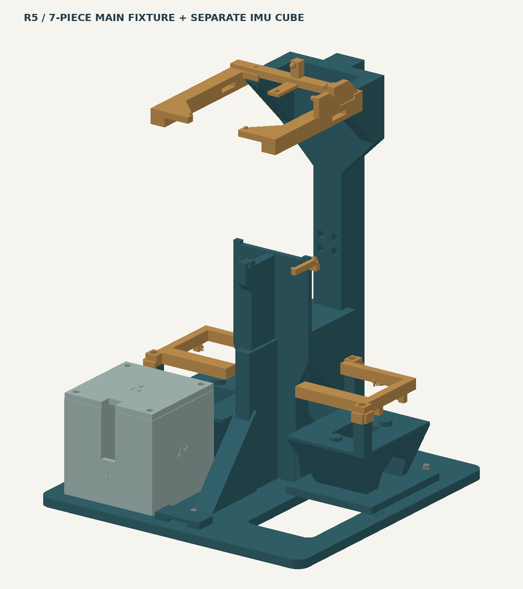
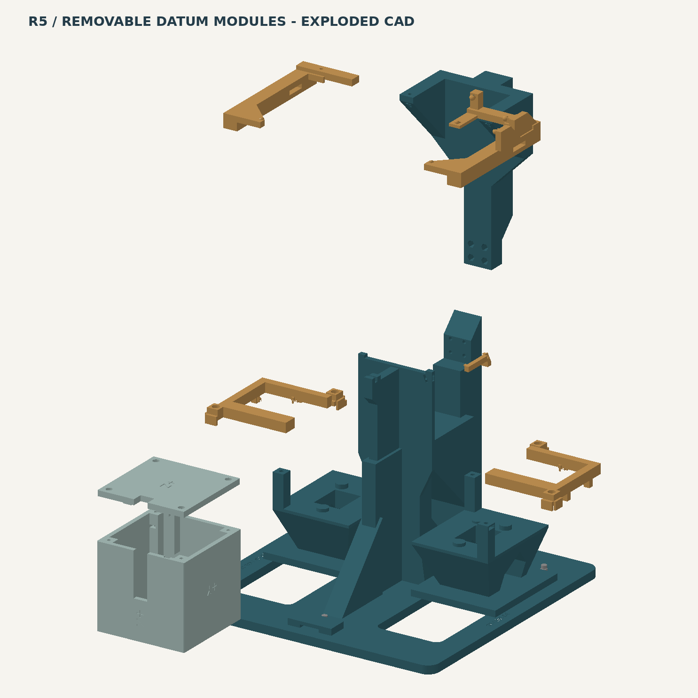

# Microduck Stand · JIG-190 R5 Compact Full15

**R5.0-rc1：用于完整 15 舵机 Microduck 的静态支承、姿态检查及校准准备。** 7 件主工装，加 1 件量规、2 件独立 IMU 盒、1 件试片，共 11 个打印件，每件各 1。

> 当前是可试制的数字样机候选版。来源包记录了工装内部 CAD 和网格检查；完整机器人碰撞与装入路径、Bambu Studio 实际打开/切片、实物打印/试装/受力/精度仍待验收。本次分享仅核对文件完整性与文档，不新增上述验收结论。

## 下载

- [中文图解指南 PDF（12 页）](docs/Microduck_JIG190_R5_Guide_CN.pdf)
- [P1S / PLA 三盘准备工程 3MF](printing/Microduck_JIG190_R5_P1S_PLA_PREPARE.3mf)
- [全部 11 个 STL](stl/)
- [原始 P1S 工艺参数 JSON](printing/P1S_project_settings.json)
- [本版文件 SHA-256](CHECKSUMS.sha256) · [导入来源与哈希](MANIFEST.json) · [来源与许可](NOTICE.md)

下载整个仓库可使用 GitHub 的 **Code → Download ZIP**。单独下载二进制文件时，进入文件页使用下载原始文件按钮。

PDF 保留来源包原样，其中提及的 `tools/calibration/`、`verify_package.py` 和完整 CAD 工具链不随本打印分享目录发布；请勿将这些命令当成本目录可执行入口。此处提供机械打印与使用说明；实际设备采集、参数生成或安装应使用对应工程、精确版本的操作手册。

## 尺寸与适配

- 底座 / 一体主架 STL：190 × 190 × 154 mm；所有单件打印 XY 小于 200 × 200 mm，STL 单位按 mm 使用。
- 默认调平脚伸出 H4 时，支架总装高 265 mm，不含机器人；承托面距板底 150 mm、默认距桌面 154 mm。
- 调平伸出量仅 H3.0–4.2 mm。R5 与 R4 的接口和脚高不同，不混装。
- 头托接固定下头壳；脚门接刚性脚 / 踝件。外壳、舵盘相位、脚垫或 IMU PCB 变体需逐项试配，完整 15 舵机配置也不代表任意改装均兼容。

## 打印清单

| 编号 / STL | 用途 | 数量 | 3MF 盘 |
| --- | --- | --- | --- |
| [01_integrated_main_190](stl/01_integrated_main_190.stl) | 一体主架、承力主体 | 1 | 2 |
| [02_upper_head_mast](stl/02_upper_head_mast.stl) | 可拆上段头桅杆 | 1 | 3 |
| [03_head_locator_left](stl/03_head_locator_left.stl) | 左头托 | 1 | 3 |
| [04_head_locator_right](stl/04_head_locator_right.stl) | 右头托 | 1 | 3 |
| [05_foot_gate_left](stl/05_foot_gate_left.stl) | 左脚姿态门 | 1 | 3 |
| [06_foot_gate_right](stl/06_foot_gate_right.stl) | 右脚姿态门 | 1 | 3 |
| [07_trunk_locator](stl/07_trunk_locator.stl) | 躯干侧向 / 偏航定位 | 1 | 1 |
| [08_multigauge](stl/08_multigauge.stl) | 水平传递及 0.6 / 0.8 / 1.0 mm 嘴间隙量规 | 1 | 1 |
| [09_imu_cube_body](stl/09_imu_cube_body.stl) | 独立六面 IMU 盒体 | 1 | 3 |
| [10_imu_cube_lid](stl/10_imu_cube_lid.stl) | 独立 IMU 盒盖 | 1 | 3 |
| [11_first_fit_coupon](stl/11_first_fit_coupon.stl) | 躯干首件试片，不单独承重 | 1 | 1 |

01–07 是主工装；08 使用后取下；09/10 独立使用。默认不使用散装硬基准垫片。

## 打印方式与初始参数

在 Bambu Studio 中**作为项目打开** 3MF，检查 P1S、0.4 mm 喷嘴、实际 PLA 和纹理 PEI。该文件由程序生成，未经本次实际 GUI 导入或切片验证，**不含 G-code、打印时间或耗材估算**。

| 参数 | 初始设置 |
| --- | --- |
| 层高 / 首层 | 0.20 / 0.20 mm |
| 墙 / 顶底 | 6 道墙；顶、底各 6 层 |
| 填充 | 30% Gyroid |
| 支撑 / Raft | 初始关闭，须以实际工具路径判断 |
| Brim | 外侧 5 mm，间隙 0.15 mm |
| 喷嘴 / 热床 | 220°C / 55°C，按实际材料复核 |

1. 先切片第 1 盘（11、08、07），打印小件试配；11 只检查躯干关键外形、X/Y 基准及 M2 孔槽。
2. 第 3 盘的头托和脚门仍需分别手持试配；躯干试片不能代替这些检查。
3. 小配合通过后再打印第 2 盘一体主架；第 3 盘还包括上段桅杆和独立 IMU 盒。
4. 逐盘检查首层、孤岛、悬垂、桥接、触点根部和螺母槽。初始无支撑不构成可打印保证；必要时调整局部工艺，避免损伤基准面后重新试配。
5. STL 已按打印朝向导出，保持 100% 比例，不自动旋转整套模型。3MF 导入失败时，可按上表导入对应 STL、手动设置与排盘，再切片检查；参数 JSON 不是打印机可直接执行的文件。

其他打印机请从 STL 自行准备工程；本页参数只提供起点，未验证其他机型、材料或喷嘴。

## 五金与辅件

使用内六角圆柱头全牙螺钉及普通六角螺母。

| 连接位置 | 螺钉 | 螺母 |
| --- | --- | --- |
| 上段桅杆搭接 | M2×12，4 颗 | M2，4 颗 |
| 左右头托 | M2×12，2 颗 | M2，2 颗 |
| 躯干 07 定位件 | M2×12，1 颗 | M2，1 颗 |
| 三点调平 | M2×12，3 颗 | M2，6 颗，每点上下各一 |
| 左右脚门 | M2.5×6，4 颗 | M2.5，4 颗 |
| IMU 盒（盒盖 4、PCB 2） | M2×12，6 颗 | M2，6 颗 |
| **合计** | **M2×12：16；M2.5×6：4** | **M2：19；M2.5：4** |

名义 M2 螺钉头径 3.8 / 高 2 mm，螺母对边 4 / 厚 1.6 mm；M2.5 螺钉头径 4.5 / 高 2.5 mm，螺母对边 5 / 厚 2 mm。采购后先实物试槽，不直接换用更高的防松螺母。

另备约 12 mm 宽的轻系留带（路径和长度实物核对）、软脚掌卸载垫、轻弹性系留、独立水平 / 倾角仪、卡尺 / 塞尺、硬平整参考台，以及 1.5 / 2 mm 内六角和对边 4 mm 小扳手。软垫不作为精密姿态基准。

## 装配与使用

1. **空架建立水平。** 先移除 02–07。三颗 M2×12 调平脚各配底部捕获螺母和顶部锁紧螺母；机器人坐标 X 向前、Y 向左时，位置为 (70,0)、(-70,70)、(-70,-70) mm。默认伸出板底 4 mm，只在 3.0–4.2 mm 内调节。卸载后调，保持螺钉不转并轻紧锁母，再复测。螺尖可能划伤桌面。
2. **使用独立参考。** 将 08 放在三个躯干承托点，以独立水平仪检查前后、左右，完成后取下。不要按待校 IMU 的“零读数”反调工装。
3. **无动力试入。** 在安全支承下分别确认 torque、policy、HOME 和 IMU 状态；由已确认的设备流程关闭力矩和策略。手扶躯干与头颈，按已核实的模型 q0 附近姿态试入；遇阻立即退出，不敲入、强压或用螺钉拉入。
4. **先承重再定位。** 先让躯干三点承重、轻系留，头颈继续由人扶持；依次装 02、03/04，建立头壳轻系留，再装 07，最后从外侧高约 5 mm 滑入 05/06 并落到肩面。这是试配起点，完整机器人入位路径仍未重验。
5. **检查硬点。** 头托接固定下头壳，不托活动嘴；脚底软垫只卸载，脚门接刚性脚 / 踝件确定姿态。所有硬接触应同时成立，螺钉锁紧工装接口，不能将关节或外壳拉弯“找零”。抵触、摇晃、部分悬空时停止，检查尺寸与适配后再修改局部设计。
6. **静态检查或校准。** 嘴部可用 08 上合适的间隙端，采完取下。独立 IMU 六面盒先核对 PCB 外形、装板方向及正交性，再脱离主架使用。机械就位后仍需对应软件、数据新鲜度和独立参考，支架本身不会关力矩、写偏置或完成标定。
7. **结束与维护。** 要进行运动，先移走定位件并将机器人移出工装，另行防坠。固定部分可保留；每次重新装夹复查水平、接触、线缆与系留。拆换舵机、改变舵盘相位或 IMU 安装后重做对应检查 / 标定。

**头托、脚门、躯干定位件在位时，不得启用策略、回 HOME 或扫角。** 不要将所有电机盲设为 2048；机械零、编码器零和 HOME 是不同概念。完成实物试配前，不将本候选版作为已验收承重或精度工装。

## 版本、来源与校验

本目录从 `Microduck_JIG190_R5_Compact_Full15` 包整理，设计版本 R5.0-rc1，源包记录日期 2026-10-13，分享整理日期 2026-11-02。PDF、3MF 及全部 11 个 STL 均保留原始字节。封面与爆炸图为源包 CAD 渲染，非实物照片。

在本目录执行 `shasum -a 256 -c CHECKSUMS.sha256` 检查下载完整性。哈希通过只说明文件一致，不证明切片、承重或标定精度。详细来源与第三方许可见 [NOTICE.md](NOTICE.md)。
